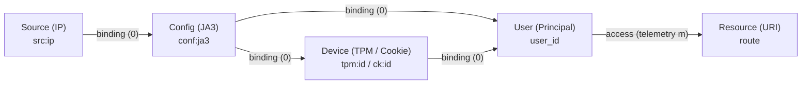
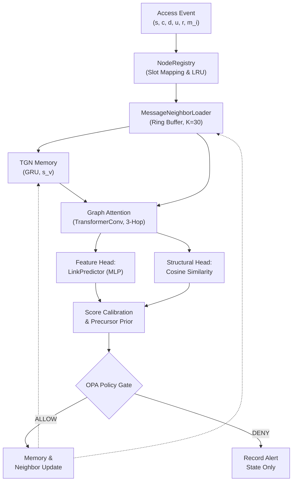
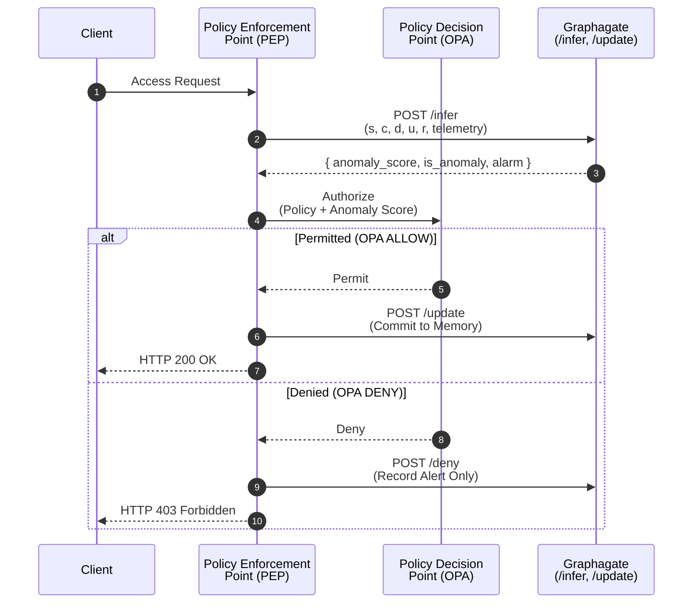

# Graphagate


Graphagate is a streaming Temporal Graph Network (TGN) for anomaly detection in Zero Trust Architectures (ZTA). It analyzes continuous authentication and authorization request streams to detect policy violations, contextual anomalies, lateral movement, and credential abuse without requiring an external graph database.

---

## Architecture Overview

Graphagate models access requests as dynamic edges over a heterogeneous graph. Each access event $`e_i = (t_i, s_i, c_i, d_i, u_i, r_i, \mathbf{m}_i)`$ is unrolled into a causal 5-edge chain spanning five typed entity nodes:

| Entity Type | Key Format | Semantics | Static Attributes ($`\mathbf{f}_v \in \mathbb{R}^{16}`$) |
|---|---|---|---|
| **Source** ($s$) | `src:<ip>` | Client network IP (RFC1918 internal / external) | Network locality flag |
| **Config** ($c$) | `conf:<ja3>` | Client TLS profile (`conf:guest` fallback) | Software client profile |
| **Device** ($d$) | `tpm:<id>` / `ck:<id>` | TPM hardware attestation or device cookie | Hardware posture tier (0–2) |
| **User** ($u$) | `usr:<principal>` | Authenticated identity / principal claim | Role & clearance claims |
| **Resource** ($r$) | `res:<route>` | Target asset / route URI | Sensitivity & risk classification |



The access edge ($u \to r$) carries dynamic request telemetry $`\mathbf{m}_i \in \mathbb{R}^7`$ (TLS validity flag, IDS probes $s_1\text{--}s_3$, HTTP method, normalized role, and clearance). The four structural binding edges carry zero-vectors $\mathbf{0}$, capturing relational pattern breaks (such as novel credential-device combinations or tool shifts).

---

## Model Components & Pipeline



1. **Hashed Identity (`hash_emb`)**: Open-world entity keys are mapped via deterministic BLAKE2b hashing into embedding buckets, producing inductive identity representations $`\mathbf{h}_v \in \mathbb{R}^{16}`$ for entities unseen during training.
2. **Recurrent Node Memory (`memory`)**: A GRU-based memory module updates continuous-time state $`\mathbf{s}_v \in \mathbb{R}^{256}`$ from interaction messages.
3. **Bounded Neighbor Store (`neighbor_loader`)**: Fixed-size in-RAM ring buffers store the last $K=30$ temporal interactions per node, enabling message passing over recent history without graph database lookups.
4. **Temporal Attention Encoder (`gnn`)**: A 3-hop `TransformerConv` encoder with residual connections embeds historical interaction features and harmonic relative time encodings $`\phi(\Delta t) \in \mathbb{R}^{32}`$.
5. **Dual Scoring Heads**:
   - **Feature Head (`link_pred`)**: A residual MLP evaluating node representations, edge telemetry, static features, and causal interaction counters $`\mathbf{c}_{vw} = [\log(1+n_{vw}), \log(1+n_v), \frac{n_{vw}}{n_v+1}]`$ to detect policy and contextual anomalies.
   - **Structural Head (`struct_proj`)**: Computes scaled cosine compatibility $`\gamma \langle \hat{\mathbf{z}}_s, \hat{\mathbf{z}}_d \rangle`$ between projected node representations, detecting unhabitual topological pairings (lateral pivots).
6. **Tail Calibration & Precursor Prior**: Edge anomaly logits are calibrated against empirical validation quantiles, boosted by an exponential kill-chain prior for entities with recent alerts ($`t_{1/2} = 72\text{h}`$), and evaluated against operational operating thresholds.
7. **Predict-Then-Update Gate**: Memory updates occur strictly after external policy evaluation (`OPA ALLOW`). Denied requests record alert state without polluting temporal memory or neighbor history.

---

## Training Protocol

The model trains under a one-class / semi-supervised regime using policy-compliant benign traffic ($y=0$):

- **Loss Formulation**:

  $$
  \mathcal{L} = \mathcal{L}_{\mathrm{NCE}}^{\mathrm{access}} + \mathcal{L}_{\mathrm{pos}}^{\mathrm{access}} + \mathcal{L}_{\mathrm{ctx}} + \sum_{(v, w) \in E^{\mathrm{bind}}} \left(\mathcal{L}_{\mathrm{NCE}}^{(v,w)} + \mathcal{L}_{\mathrm{pos}}^{(v,w)}\right)
  $$

  - **InfoNCE Ranking**: Ranks the true destination against $K=5$ negative destinations (75% uniform random, 25% active batch destinations).
  - **Positive BCE Anchoring**: Prevents logit drift, anchoring nominal benign scores for quantile calibration.
  - **Contextual Regularization**: Applies Gaussian perturbations to access telemetry to penalize off-nominal attributes.
- **Two-Stage Schedule**:
  - **Stage 1**: End-to-end training across memory, attention backbone, and scoring heads using AdamW with cosine annealing.
  - **Stage 2**: Memory and attention layers are frozen; the link predictor MLP is fine-tuned at reduced learning rate ($`\mathrm{lr} = 10^{-4}`$).

---

## Limitations and Threat Model

- **External Validity**: Published benchmark numbers are evaluated primarily on continuous synthetic streams. Public enterprise datasets containing simultaneously verified user identities, TLS fingerprints, and labeled lateral movement are scarce. PicoDomain provides real fields across all five nodes but covers a small environment (6 hosts, 2.67 days); LANL auth lacks TLS/config telemetry.
- **Policy Gate Coupling (Poisoning vs. Starvation)**: Memory updates commit only on policy-admitted events (`OPA ALLOW`). A stealthy attack that evades policy rules can poison the historical baseline, while legitimate requests rejected by policy cannot update entity habituality (starvation).
- **Precursor Prior**: The kill-chain prior boosts scores based on preceding reconnaissance alerts. An adversary executing lateral movement without prior detectable reconnaissance does not trigger this prior.
- **Cold Start**: Newly observed entities lack interaction history; their anomaly scores initially reflect higher uncertainty until interaction baselines accumulate.
- **Unauthenticated Internal Endpoints**: The microservice endpoints (`/infer`, `/update`, `/deny`) do not implement authentication internally and are designed to be deployed on an isolated network accessible only by trusted Policy Enforcement Points.

---

## Quickstart & Execution

### Docker Compose Profiles

```bash
# 1. Train the streaming model and save checkpoints to public/
docker compose --profile training-tgn up

# 2. Run train/replay verification harness
docker compose --profile verify-tgn up

# 3. Start the HTTP inference service (Host 8888 -> Container 8088)
docker compose --profile serve-tgn up
```

### Standalone Python Execution

```bash
# Install package dependencies
uv pip install -e .

# Run training
python -m graphagate.train_tgn

# Run verification harness
python -m graphagate.verify_tgn

# Start FastAPI serving API
python -m graphagate.serve_api
```

---

## REST API & Orchestrator Integration

The inference microservice (`src/serve_api.py`) runs on FastAPI at port `8088` (mapped to host `8888`):

| Endpoint | Method | Role | Mutates State |
|---|---|---|---|
| `/health` | `GET` | Service readiness probe (returns 503 while loading, 200 when ready) | No |
| `/infer` | `POST` | Scores access request tuple; admits keys into registry | Registry admission only |
| `/update` | `POST` | Commits policy-admitted request (`OPA ALLOW`) to memory and neighbor buffers | Yes |
| `/deny` | `POST` | Records alert triggers for policy-denied requests (`OPA DENY`) | Alert state only |
| `/score` | `POST` | Combined scoring with conditional self-update (testing / standalone mode) | Yes (if benign) |
| `/persist` | `POST` | Serializes current in-RAM state and registry to `public/` | Disk write |

### Integration Flow



Detailed integration examples (Go client implementation, OPA Rego policies, environment settings) are available in [`docs/development/orchestrator_integration.md`](docs/development/orchestrator_integration.md).

---

## Project Layout

```text
docker/
└── Dockerfile               # CUDA-enabled container specification
docs/
├── development/             # Orchestrator integration and architectural notes
├── opa-policies/            # Reference OPA Rego policy definitions
└── references/              # External dataset evaluation runbooks
gui/                         # Browser-based 3D graph visualizer
public/                      # Training checkpoints (checkpoint.pt, stats.json)
scripts/                     # Dataset retrieval and extraction utilities
src/
├── config.py                # Hyperparameters, dimensions, and path configuration
├── calibration.py           # Threshold calibration & empirical tail routing
├── eval_common.py           # Shared evaluation metrics & history features
├── netclass.py              # Network locality classification & guest mapping
├── report_metrics.py        # Statistical comparisons & table generation
├── serve_api.py             # FastAPI REST microservice
├── serve_tgn.py             # Serving primitives, memory updates, and persistence
├── train_tgn.py             # Self-supervised training & calibration pipeline
├── verify_tgn.py            # Stream replay parity & verification test harness
├── data/
│   ├── access_policy.py     # Bell-LaPadula authorization reference model
│   ├── lookup_rules.py      # Stateful binding lookup rules
│   └── stream_synthetic.py  # ZTA stream simulator (policy, lateral, theft)
└── model/
    ├── gnn.py               # GraphAttentionEmbedding (TransformerConv encoder)
    ├── heads.py             # LinkPredictor & StructuralProjector scoring heads
    ├── neighbor.py          # MessageNeighborLoader (bounded ring buffer)
    ├── registry.py          # NodeRegistry (dynamic admission & LRU slots)
    └── tgn.py               # ZTATemporalGraphNetwork model definition
tests/                       # Evaluation suites, ablations, baselines & parity tests
```

---

---

## Appendix: Synthetic Dataset Generation Details

This appendix reports the detailed configuration of the synthetic workload generator used for the benchmark dataset. These parameters are omitted from the main text for conciseness but are provided here to support reproducibility.

### A.1 Entity Space and Open-World Allocation

The benchmark contains $N=200{,}000$ chronologically ordered access events covering approximately 306 days of simulated activity.

<!-- TODO: insert here the table describing the entity space (users, devices, resources, ...). It was not included in the source text. -->

User 0 is reserved for an automated maintenance account operating from three dedicated servers. Human users may occasionally access these systems, while ordinary workstations can be shared by multiple users.

Devices are distributed across three security-posture tiers:

- **Tier 0**: unmanaged devices that do not present client certificates;
- **Tier 1**: managed devices using software-backed certificates;
- **Tier 2**: hardware-attested devices using a Trusted Platform Module (TPM).

To prevent novelty from becoming a trivial anomaly signal, benign and malicious activity draw identifiers from common open-world pools. Fresh slots are used for events such as IP roaming, device-cookie resets, client-version updates, and attack-related entity substitutions.

### A.2 Benign Behavioral Model

#### A.2.1 Multilevel Access-Control Policy

Each request is generated under a Bell–LaPadula-inspired multilevel access policy. Users belong to one of four roles with associated clearance levels: `guest` (0), `operator` (1), `manager` (2), and `admin` (4).

Resources belong to one of five security classifications: `PUBLIC`, `INTERNAL`, `CONFIDENTIAL`, `SECRET`, and `TOP_SECRET`, and may additionally belong to one or more of six compartments: `public`, `hr`, `finance`, `ops`, `nuclear`, and `security`.

Read operations satisfy the Simple Security Property,

$$
\mathrm{clearance}(u) \geq \mathrm{classification}(r),
$$

whereas mutating operations satisfy the corresponding $\ast$-Property,

$$
\mathrm{clearance}(u) \leq \mathrm{classification}(r).
$$

Compartment inclusion is also required. A single trusted sanitization endpoint allows controlled administrative write-down.

#### A.2.2 Habitual and Exploratory Access

Each user is assigned a habitual profile containing 50% of the route–method pairs authorized for the corresponding role. During normal operation, a request targets a habitual endpoint with probability

$$
1-p_{\mathrm{explore}},
$$

and another authorized endpoint with probability

$$
p_{\mathrm{explore}} = 0.15.
$$

This controlled exploration ensures that unusual but policy-compliant resource access is not automatically equivalent to malicious behavior.

#### A.2.3 Temporal Activity Model

Event inter-arrival times are sampled from a non-homogeneous Poisson process. For consecutive events,

$$
\Delta t = \max\left(1,\left\lfloor \Delta\tau \right\rfloor\right),
\qquad
\Delta\tau \sim \mathrm{Exp}\left(\lambda(t)\right),
$$

with time-dependent scale

$$
\lambda(t)=
\begin{cases}
45\ \mathrm{s}, & \text{weekday working hours (08:00–18:00)},\\
600\ \mathrm{s}, & \text{weekday nights},\\
1200\ \mathrm{s}, & \text{weekends}.
\end{cases}
$$

This produces daily and weekly activity cycles while retaining stochastic variation in request timing.

#### A.2.4 Resource Popularity

Resource-access probabilities follow a discrete Zipf distribution,

$$
w(r)=\frac{1}{\left(\mathrm{rank}(r)+1\right)^s},
\qquad s=1.2.
$$

The popularity rank is assigned through a random permutation of the 1000 resources at initialization. This prevents the numeric resource identifier itself from encoding frequency information and preserves comparable destination marginals across benign and malicious traffic.

#### A.2.5 Mobility, Churn, and Background Noise

The benign stream includes several sources of organizational variability:

- **Shared devices:** $p_{\mathrm{shared}}=0.20$ of physical devices are assigned to 2–4 legitimate users.
- **Hot-desking:** novel but legitimate user–workstation associations occur with probability $p_{\mathrm{hotdesk}}=0.02$.
- **Network roaming:** $p_{\mathrm{roam}}=0.10$ of benign requests originate outside the user's registered office or home network.
- **Fresh network sources:** conditional on roaming, a previously unseen IP address is selected with probability $p_{\mathrm{new\_src}}=0.30$ from a shared pool of 6000 addresses.
- **Software releases:** new client versions are introduced with rate $p_{\mathrm{release}}=2.5\times10^{-4}$ per step.
- **Software adoption:** existing endpoints adopt a released version with probability $p_{\mathrm{adopt}}=0.05$ on subsequent accesses.
- **Ad-hoc client configurations:** non-habitual command-line or client configurations occur with probability $p_{\mathrm{new\_cfg}}=0.003$.
- **Device-cookie resets:** cookie-identified devices lose their persistent token with probability $p_{\mathrm{wipe}}=10^{-3}$ and subsequently reappear as cold nodes.
- **Benign policy denials:** legitimate users generate unauthorized requests with probability $p_{\mathrm{denial}}=0.02$.
- **IDS background noise:** each of the three Snort-derived sensor indicators independently generates false positives with probability $p_{\mathrm{fp}}=0.01$.

These mechanisms create benign structural novelty, reducing the likelihood that the detector learns simplistic rules based solely on first-seen relationships or identifiers.

### A.3 Attack Injection Parameters

The generator assigns each event to one of six mutually exclusive classes: benign traffic, policy violation, contextual/reconnaissance anomaly, lateral movement, credential theft, or benign denial. Malicious events account for 1.34% of the complete stream.

#### A.3.1 Credential Theft

Credential-theft scenarios model an attacker operating with valid credentials stolen from a human user. Hardware-attested Tier 2 credentials are excluded from theft scenarios.

Incidents are initiated with probability

$$
p_{\mathrm{theft}} = 1.2\times10^{-3}
$$

per generation step. Each incident produces a sequence of 3–6 malicious requests interleaved with benign traffic at rate

$$
p_{\mathrm{interleave}} = 0.06.
$$

To make credential misuse difficult to detect from isolated request features, the attacker reproduces part of the victim's environment:

- the victim's device cookie is replayed with probability $p_{\mathrm{replay}}=0.50$;
- otherwise, a fresh device identifier is allocated from the shared open-world pool;
- a known fleet proxy is used with probability $p_{\mathrm{known\_src}}=0.70$;
- the victim's habitual JA3 configuration is reproduced with probability $p_{\mathrm{mimic\_cfg}}=0.70$;
- requested resources remain compatible with the victim's assigned role.

As a consequence, many credential-theft requests contain individually plausible attributes. The anomaly is therefore primarily encoded in the historical consistency of configuration–device–user relationships.

#### A.3.2 Lateral Movement

Lateral movement is modeled as post-compromise activity. Initial compromise mechanisms such as phishing or zero-day exploitation are treated as out-of-band events and do not directly appear as graph interactions.

An uncompromised host becomes compromised with per-step hazard

$$
p_{\mathrm{comp}} = 6\times10^{-4}.
$$

A compromised host progresses through three stages:

1. **Reconnaissance:** 1–3 requests with elevated sensor activity and untrusted client configurations;
2. **Lateral expansion:** 5–11 requests directed toward protected resources;
3. **Dwell and remediation:** 0–4 requests before the host returns to a clean state.

During reconnaissance, the three sensor indicators trigger with probabilities $0.80$, $0.50$, and $0.20$, respectively.

Compromised systems alternate malicious and benign actions: attack requests are emitted with probability $0.30$, while legitimate user activity continues with probability $0.70$.

Each compromised host also harvests between one and three credentials. Credentials are sampled from locally cached sessions with probability

$$
p_{\mathrm{cached}} = 0.70,
$$

and from unrelated fleet identities otherwise. During lateral expansion, foreign harvested credentials are used with probability

$$
p_{\mathrm{foreign}} = 0.70,
$$

creating previously unseen or historically unlikely device–user associations. In the remaining 30% of lateral actions, the local identity is used to access non-habitual but authorized resources.

During the lateral-expansion phase, TLS and IDS indicators are intentionally kept close to benign conditions, with trusted TLS configuration and background sensor rate $p_{\mathrm{fp}}=0.01$. This design forces detection to rely primarily on temporal and relational structure rather than explicit perimeter alerts.

### A.4 Temporal Partitioning and Leakage Controls

#### A.4.1 Chronological Partition

The event stream is partitioned strictly in chronological order:

| Split | Days | Events | Share |
|---|---|---|---|
| Training | first 214 | $N_{\mathrm{train}}=140{,}000$ | 70% |
| Validation | 215–245 | $N_{\mathrm{val}}=20{,}000$ | 10% |
| Test | 246–306 | $N_{\mathrm{test}}=40{,}000$ | 20% |

The training partition is used for one-class temporal representation learning, validation for score calibration and threshold selection, and the test partition exclusively for sequential event-by-event evaluation.

#### A.4.2 Rationale for Chronological Evaluation

In continuous-time graph models, every observed edge can modify node memory and temporal neighborhoods. A random split would therefore allow future interactions to influence the representation used to evaluate earlier events, violating temporal causality.

Chronological evaluation instead reproduces deployment conditions, where each prediction is based exclusively on previously observed interactions, while also exposing the model to entity churn, behavioral drift, and attack campaigns occurring later in the stream.

#### A.4.3 Leakage-Prevention Measures

The experimental pipeline applies the following safeguards against future-information leakage:

1. **One-class training.** Loss computation and temporal-memory updates during training use only ground-truth benign events ($y_i=0$); attack events are excluded.
2. **Epoch-level state reset.** Node memories, temporal-neighbor buffers, pairwise recency tables, and interaction counters are reinitialized at each training epoch.
3. **Open-world identity projection.** Entity identifiers are deterministically mapped with BLAKE2b into $10^5$ embedding buckets, allowing unseen test-time entities to be represented without vocabulary retraining.
4. **Bounded temporal recency.** Elapsed time is capped at $\Delta_{\max}=7$ days, while absolute timestamps are excluded from the model input to prevent time itself from identifying the dataset split.
5. **Validation-only calibration.** Score calibration and threshold selection use validation data only. Alert-related state is cleared before test replay.
6. **Policy-gated online updates.** During sequential evaluation, temporal memory is updated only for requests accepted by the PDP and satisfying the configured sensor-integrity conditions. Denied events therefore cannot directly modify the behavioral baseline.


## License

This project is licensed under the MIT License — see the [LICENSE](LICENSE) file for details.
